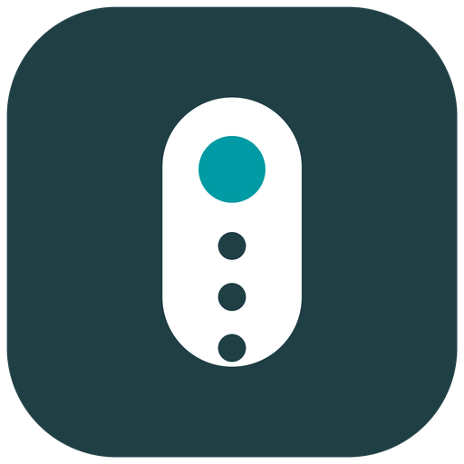

# EGLO connect.z Remote for Home Assistant



[EGLO connect.z Smart Home Fernbedienung 2.0](https://www.eglo.com/) (AwoX
`ERCU_3groups_Zm`, also sold as EGLO 99099) paired with
[ZHA](https://www.home-assistant.io/integrations/zha/) shows up as a plain
Zigbee device with an Identify button, RSSI and LQI - and nothing else. It
presses register internally, but Home Assistant offers **no triggers** for
automations.

This integration fixes that. It listens to the remote's Zigbee commands and
exposes every button as:

- a device trigger on the integration's device card (pick the device in the
  automation editor and choose the button and gesture), and
- an `event.*` entity (for example `event.eglo_connect_z_remote_416e_action`)
  whose `event_type` is the pressed action - the recommended trigger style
  for buttons since it can be renamed and survives re-pairing.

Works fully locally. No MQTT broker, no Zigbee2MQTT, no cloud.

Under the hood the integration registers a small ZHA quirk shim that makes
the remote's vendor-specific Zigbee commands parseable and re-emits every
press as one canonical event, and translates both those events and the
standard ones into actions. When the shim is not yet active (for example
before the first restart after installing), everything except the colour
and refresh buttons still works from the plain ZHA events.

## Supported hardware

| Device page shows                  | Supported |
| ---------------------------------- | --------- |
| Manufacturer **AwoX**, model **ERCU_3groups_Zm** (Fernbedienung 2.0) | yes |
| Manufacturer **AwoX**, model **ERCU_Zm** (older remote)              | yes |
| Anything else (for example Tuya `_TZ3000_`)                          | no  |

Home Assistant 2024.8 or newer is required (event entities).

## Installation

1. HACS > the three-dot menu > **Custom repositories** > add
   `https://github.com/PurpleBooth/ha-eglo-connect-z-remote` with category
   **Integration**.
2. Install **EGLO connect.z Remote**, then restart Home Assistant.
3. Settings > Devices & services > **Add integration** > **EGLO connect.z
   Remote** and pick your remote from the list. The remote must already be
   paired with ZHA.
4. Restart Home Assistant once if a repair hint asks for it: the quirk shim
   needs to be loaded before ZHA initializes the remote.
4. Press a button: the device card (area assignable) shows the Action event
   entity updating, and the trigger list offers every button.

Removing the integration is equally clean: delete it in the UI and the
device card and entity go with it. The ZHA device itself is never touched.

## Triggers

| Button                    | Action (`event_type` / device trigger subtype) |
| ------------------------- | ---------------------------------------------- |
| On                        | `on`                                           |
| Off                       | `off`                                          |
| Dim up / down (short)     | `brightness_step_up` / `brightness_step_down`  |
| Dim up / down (held)      | `brightness_move_to_level` (carries `level`)   |
| Colour temp (short)       | `color_temperature_step_up` / `_down`          |
| Colour temp (held)        | `color_temperature_move` (carries `color_temperature` in mireds) |
| Red / green / blue (short)| `red` / `green` / `blue`                       |
| Red / green / blue (held) | `red_long` / `green_long` / `blue_long`        |
| Yellow (short)            | `yellow`                                       |
| Refresh, candle (short/long) | `refresh` / `refresh_long`                  |
| Colour cycle (short/long) | `refresh_colored` / `refresh_colored_long`     |
| Favourite 1 / 2 (short)   | `recall_1` / `recall_2`                        |
| Favourite 1 / 2 (held)    | `recall_1_long` / `recall_2_long`              |

The trigger list in the automation editor shows these as gestures, for
example "Turn on pressed" or "Group 2 held" (`Turn on` maps to `on`).

### Example automation

```yaml
triggers:
  - trigger: event.received
    target:
      entity_id: event.eglo_connect_z_remote_416e_action
    options:
      event_type:
        - "on"
        - "off"
actions:
  - choose:
      - conditions:
          - condition: state
            entity_id: event.eglo_connect_z_remote_416e_action
            attribute: event_type
            state: "on"
        sequence:
          - action: light.turn_on
            target:
              entity_id: light.my_lamp
      - conditions:
          - condition: state
            entity_id: event.eglo_connect_z_remote_416e_action
            attribute: event_type
            state: "off"
        sequence:
          - action: light.turn_off
            target:
              entity_id: light.my_lamp
```

Or import the ready-made
[light blueprint](blueprints/eglo_remote_lights.yaml) which covers On/Off,
dim steps, colour-temperature steps and both favourite buttons.

## Behaviour notes

- **Spurious "On"**: the hardware emits an extra `on` right after colour,
  colour-temperature, refresh and favourite presses. The integration
  suppresses it (within 0.5 s) the same way Zigbee2MQTT does, so automations
  do not fire twice.
- **Value jitter**: colour values arrive as 254/255, 84/85, 169/170
  depending on the press; the integration normalises them into one action
  per button.
- **Zones**: the zone buttons themselves transmit nothing over Zigbee (the
  same is true in Zigbee2MQTT), so they cannot be normal triggers. The shim
  instead reads the broadcast group (32778/32779/32780) of every command and
  attaches a `zone` attribute (1-3) to each action, and emits a
  `zone_selected` action whenever the zone changes. The zone switch becomes
  visible on the next press after switching.
- **Re-pairing survives**: actions are keyed on the remote's stable IEEE
  address. If the remote is removed and re-paired, keep the integration
  configured and it picks the remote up again.
- Advanced use: every action is also published on the `eglo_remote_action`
  bus event with `device_ieee`, the action name, the `zone` and any raw
  values (`level`, `color_temperature`) for templating.

## Local development

```sh
python3 -m venv .venv
.venv/bin/pip install -r requirements_test.txt
.venv/bin/ruff format custom_components/ tests/
.venv/bin/ruff check custom_components/ tests/
.venv/bin/pytest tests/
```

The tests run against the pinned Home Assistant test harness and cover the
command translation (from live captures of the real remote), the config
flow, setup and unload, the event entity, and the device trigger platform.

## References

- [Zigbee2MQTT EGLO 99099 device page](https://www.zigbee2mqtt.io/devices/99099.html) -
  the command map in this integration was cross-checked against its converter
- [Z2M issue #16890: EGLO RCU3](https://github.com/Koenkk/zigbee2mqtt/issues/16890) -
  captured Zigbee traffic of this exact remote
- [Local custom ZHA quirks guide](https://community.home-assistant.io/t/zigbee-guide-how-to-add-setup-local-custom-zha-device-handlers-also-known-as-quirks-in-the-zha-integration/683473) -
  the alternative quirk-based approach, documented here for reference

## Support and contributing

Bugs and feature requests go to the
[issue tracker](https://tangled.org/billie.codes/ha-eglo-connect.z-smart-home-fernbedienung-2.0/issues).
Pull requests are welcome; run the tests and ruff before submitting.

## License

[MIT](LICENSE)
